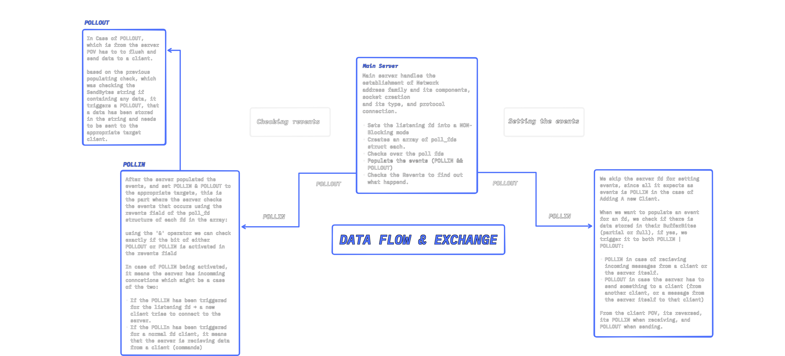

*This project has been created as part of the 42 curriculum by ayel-bou.*

# 42 Internet Relay Chat


## Description

`ft_irc` is an IRC server written in C++98 as part of the 42 curriculum. The goal is to understand how a real network protocol works by implementing the server side of it from scratch: raw TCP sockets, non-blocking I/O, and the IRC protocol ([RFC 2812](https://datatracker.ietf.org/doc/html/rfc2812)).

The server runs as a single process with a single `poll()` loop that multiplexes the listening socket and every client socket for both reading and writing. There is no forking, no threading, and no external library. Incoming data is buffered per client, so commands split across several TCP packets are reassembled before being parsed.

**Features**
- Connection password check (`PASS`), then registration with `NICK` and `USER`
- `JOIN` and `PRIVMSG` (to a nick or to a channel); channel messages are forwarded to every other member
- Regular users and channel operators
- Operator commands: `KICK`, `INVITE`, `TOPIC`, `MODE`
- Channel modes: `i` (invite-only), `t` (topic restricted to operators), `k` (channel key), `o` (operator privilege), `l` (user limit)

## Instructions

**Compile**
```
make
```
Other rules: `make clean`, `make fclean`, `make re`.

**Run**
```
./ircserv <port> <password>
```
- `port`: the port the server listens on
- `password`: the password every client must provide to connect

**Test**

Connect to the server's host and port and provide the password. With `nc`:
```
nc -C 127.0.0.1 <port>
PASS <password>
NICK alice
USER alice 0 * :Alice
JOIN #test
...
```

**Instructions for IRC Client (WeeChat)**

## Using WeeChat

WeeChat was used as the reference client.

**Connect**
```
/server add ft_irc 127.0.0.1/<port> -notls -password=<password>
/set irc.server.ft_irc.nicks "nickname"
/set irc.server.ft_irc.username "username"
/set irc.server.ft_irc.realname "realname"
/connect ft_irc
```
`-notls` is needed because recent WeeChat versions enable TLS by default and the server speaks plain TCP. On older versions, use `-nossl`.

Basic commands
----------------------------------------------------
| Action | Command |
|---     |      ---|
| Join a channel (with key) | `/join #chan [key]` |
| Private message | `/msg bob hello` |
...
-----------------------------------------------------

Operator commands
-----------------------------------------------------------------------
| Action | Command |
|---     |      ---|
| Kick | `/kick bob [reason]` |
| Invite | `/invite bob #chan` |
| View / set topic | `/topic` · `/topic new topic` |
| Invite-only | `/mode #chan +i` / `-i` |
| Topic restricted to ops | `/mode #chan +t` / `-t` |
| Channel key | `/mode #chan +k secret` / `-k` |
| Operator privilege | `/mode #chan +o bob` / `-o bob` (or `/op bob`) |
...------------------------------------------------------------------------

## Resources

- [RFC 2812 – Internet Relay Chat: Client Protocol](https://datatracker.ietf.org/doc/html/rfc2812)
- [RFC 1459 – Internet Relay Chat Protocol](https://datatracker.ietf.org/doc/html/rfc1459)
- `man 2 poll`, `man 2 socket`, `man 2 recv`, `man 2 send`

**Use of AI**

AI (Claude) was used as a tutor and reviewer, not as a code author. It was used to:
- explain concepts (non-blocking sockets, `poll()`, TCP message framing, IRC protocol behaviour).
- review code I wrote and point out bugs and edge cases.
- cross-check my implementation against RFC 2812.

All the code was written by me, and I tested and can explain every part of it.

***

## Data Flow & Exchange



## Design Structure of The Project

